# ctxtree 🌳

<p align="center">
  <strong>WizTree for Claude's Context Window</strong><br>
  Scan, visualize, and surgically delete token bloat across your Claude Code sessions with zero narrative jumps.
</p>

<p align="center">
  <a href="https://github.com/Yashwant00CR7/ctxtree/blob/main/LICENSE"></a>
  <a href="https://nodejs.org/">= 18"></a>
  
  
  
  
  
</p>

---

<p align="center">
  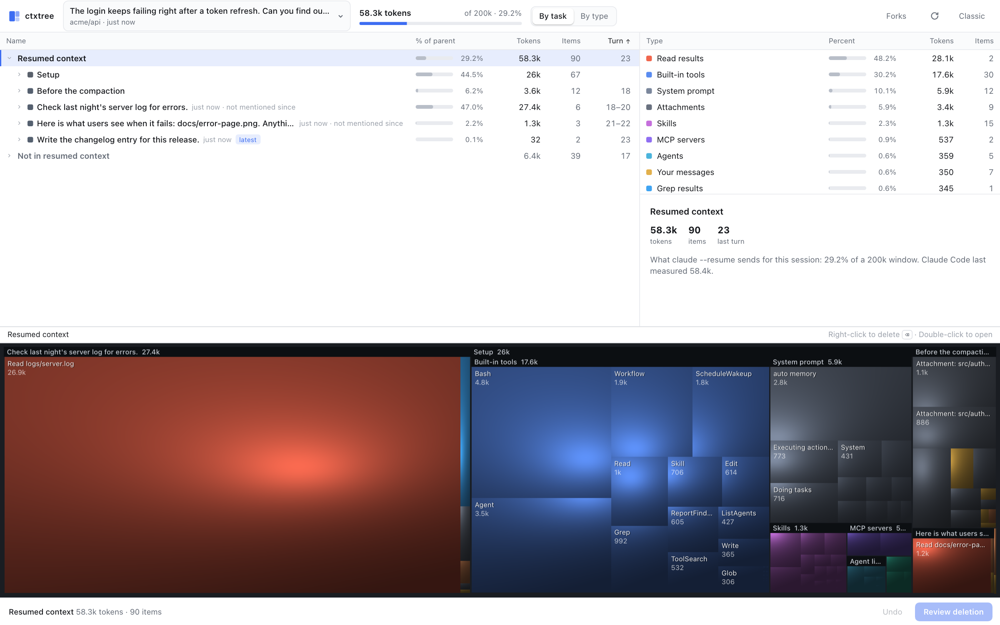
</p>

---

## ⚡ Quick Start in 30 Seconds

Get started immediately with zero configuration and zero external dependencies:

```bash
# 🌐 Option 1: Launch the Interactive Web Dashboard (Instant WizTree GUI)
npx ctxtree

# 💻 Option 2: Run a Sub-Second Terminal Context Audit across All Sessions
npx ctxtree --cli

# 🔌 Option 3: Install the Native Claude Code Mod (Docked Side-by-Side in Your Chat)
claude plugin marketplace add /path/to/ctxtree
claude plugin install ctxtree@ctxtree
claude plugin install ctxtree-ui@ctxtree
# Then inside Claude Code:
/ctxtree
```

> [!TIP]
> **Zero Installation Required**: Running `npx ctxtree` spins up a secure local loopback server using only Node.js built-ins (`node:fs`, `node:http`, `node:crypto`). Nothing is sent across the network.

---

## 📊 The "Why ctxtree?" Feature Matrix

Standard compaction in LLM coding harnesses is a sledgehammer: it obliterates fine-grained code structure, imports, and error stack traces into a lossy paragraph summary, disorienting the model. 

**`ctxtree` is a precision scalpel.**

### The Sledgehammer vs The Scalpel

| Feature | 🔨 Standard `/compact` (The Sledgehammer) | 🔬 `ctxtree` (The Precision Scalpel) |
|---|---|---|
| **Philosophy** | Lossy global text condensation | Surgical removal of dead tokens; preserve 100% of the rest |
| **Token Savings** | 40% – 60% (uncontrollable loss) | **70% – 85%** (targeted pruning of logs, test runs, stale reads) |
| **Continuity & Grounding** | ❌ **High risk of narrative jumps**; model forgets exact lines & file shapes | ✅ **Zero-jump continuity guard**; leaves exact transcripts byte-for-byte identical |
| **Stale File Detection** | ❌ Blind to superseded file reads | ✅ **Automatic `[out of date]` detection** when files are re-read or modified |
| **Granularity** | ❌ Whole conversation compressed at once | ✅ **Block-by-block**: Drop tool results, shrink inputs, or synthesize bridges |
| **Boot Overhead Pruning** | ❌ Re-announces every MCP schema & skill turn after turn | ✅ **Prunes MCP schemas, memory & CLAUDE.md** via launch profiles |
| **Safety & Undoability** | ⚠️ Destructive in-place rewrite of history | 🛡️ **Instant ~35ms APFS CoW forks** with verified 8-point invariants & 30-day restore |
| **Claude Collaboration** | ❌ Autonomous, opaque condensation | 🤝 **Claude stages, human applies** via dedicated MCP inspection & staging tools |

### Real-World Context Reclaim

```text
Before ctxtree:  ████████████████████████████████████████ [142,480 tokens (71% window)]
After ctxtree:   ███████████                              [ 38,120 tokens (19% window)]
Savings:         ▲ 104,360 tokens reclaimed (73.2% reduction) with 0 continuity loss
```

---

## 🧭 Two Ways to Use ctxtree

| Dimension | ⚡ Live Inside Claude Code (The TUI Mod) | 🌐 Outside Claude Code (Web UI & CLI) |
|---|---|---|
| **Primary Target** | Active running conversation in real-time | Any past or present session on disk across all projects |
| **How Edits Land** | Active conversation rebuilt cleanly in-place; keep coding | Verified, non-destructive APFS session fork with launch profile |
| **Interface** | Native terminal split-pane docked directly beside your chat | High-DPI browser WizTree dashboard + streaming terminal CLI |
| **Claude Collaboration** | Ask Claude to inspect context and stage cleanups collaboratively | Manual point-and-click or automated scripted CLI flags |
| **Special Superpowers** | Non-blocking browsing while Claude generates tokens | MCP boot stripping, uncompacting lossy history, branch switching |
| **Trigger Command** | `/ctxtree` | `npx ctxtree` |

---

## 🔍 Visual Feature Deep-Dives

### 1. 🌳 Interactive Cushion Treemap
Expose token hogs in milliseconds. Category color-coding separates **Setup** (blue), **Tool Results** (red/orange), **Conversation** (green), and **Attachments**.

<p align="center">
  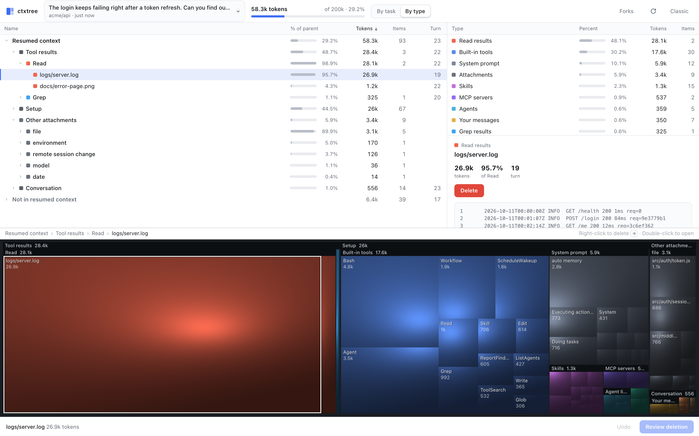
  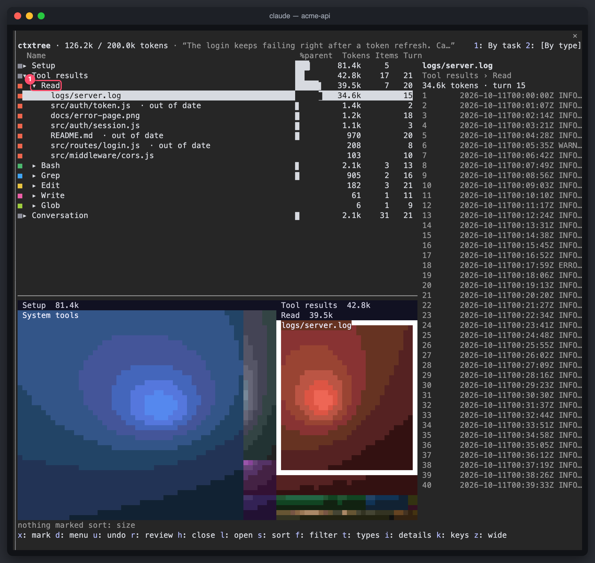
</p>

- **Squarified Cushion Treemap**: Blocks are strictly proportional to token consumption. Deep nested structures (e.g., individual tool results inside a subtask) render with clear cushion contours.
- **Dual Token Accounting**:
  - **Distinct Size**: Raw token footprint of an individual output or message.
  - **Allocated Tokens (`Distinct × Turns Resident`)**: Reveals the true cost of early reads. A 10k-token log read in Turn 2 that sits idle for 30 turns quietly burns **300k+ billed context tokens**.
- **Instant Hit Testing**: Click any rectangle in either the Web UI or the terminal TUI to instantly focus its node in the tree and view metadata and content previews.

> [!TIP]
> Click any type header (like **Bash** or **Read**) to dim all unrelated blocks on the treemap, instantly isolating which tool is dominating context consumption.

---

### 2. 📖 Task-Oriented Narrative
Rather than forcing you to sift through unstructured message arrays, `ctxtree` groups your session into high-level user tasks based on your actual intent:

<p align="center">
  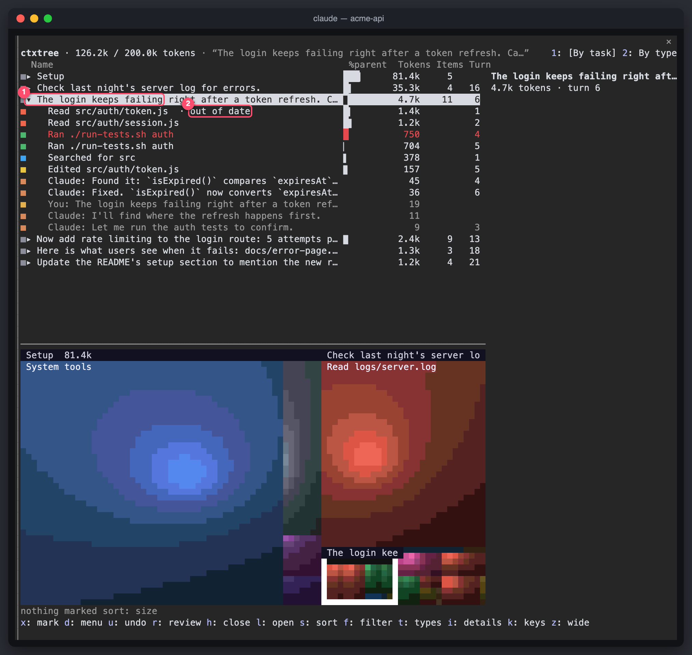
</p>

- **Intelligent Stale Detection (`[out of date]`)**: When a file read in Turn 3 is edited in Turn 14, `ctxtree` flags the Turn 3 read as stale. Dropping it is 100% safe because Claude already retains the newer file state.
- **Re-run & Abandonment Tracking**: Highlights early test failures in bright red, along with investigation artifacts (`[not mentioned since]`) that were touched once and never referenced again.

---

### 3. ✂️ Surgical Deletion & Tombstones
Choose the exact level of pruning required for each artifact without breaking LLM tool expectations:

<p align="center">
  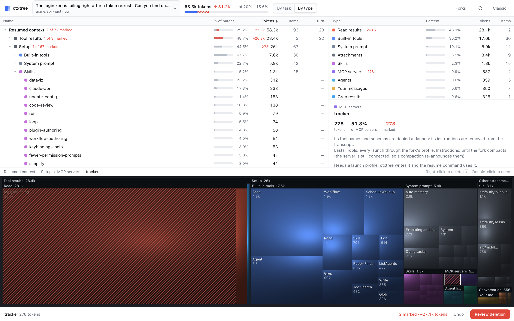
  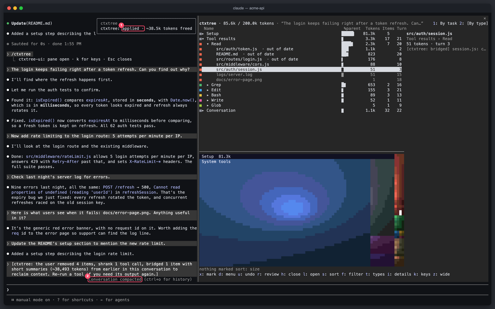
</p>

#### The Three Surgical Operations:
1. **Drop (Smart Tombstone)**:
   Replaces massive tool outputs with a concise one-line tombstone. The `tool_use` record remains completely intact, preserving caller/callee alternation:
   ```text
   [ctxtree: removed Read result for /acme-api/logs/server.log (~34,529 tokens) to reclaim context. Re-run it if you need it again.]
   ```
2. **Shrink (Payload Truncation)**:
   Condenses massive tool inputs (such as full-file write payloads) down to the first line and a byte/line summary note.
3. **Continuity Bridge (Contextual Micro-Summary)**:
   Drafts a targeted contextual bridge preserving critical variable names, endpoints, and architectural decisions identified by the Continuity Guard:

<p align="center">
  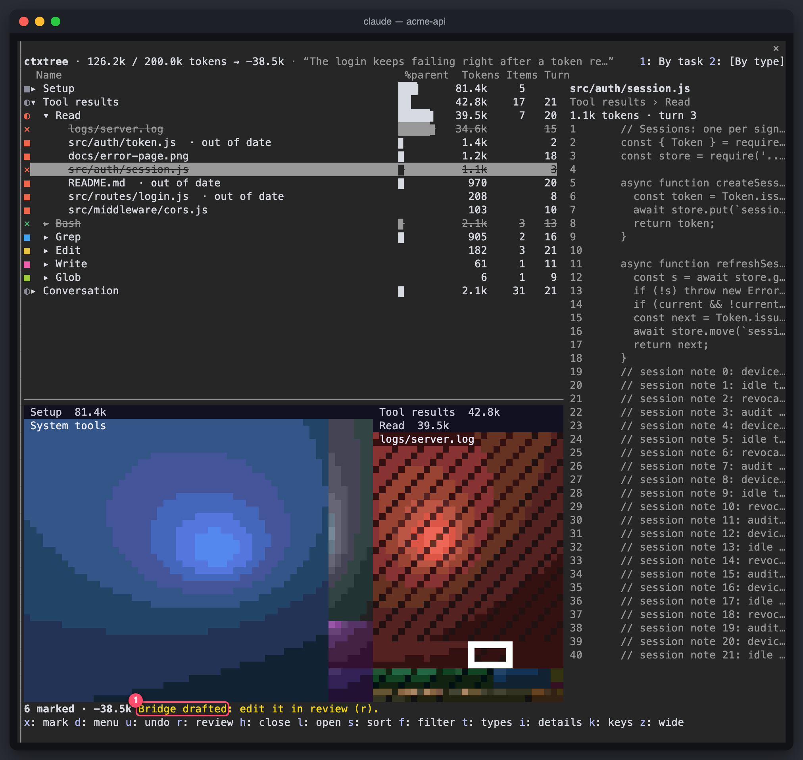
</p>

---

### 4. ⚡ Live Inside Claude Code (The TUI Mod)
Dock an interactive, real-time context tree directly inside Claude Code's terminal interface without leaving your development flow:

<p align="center">
  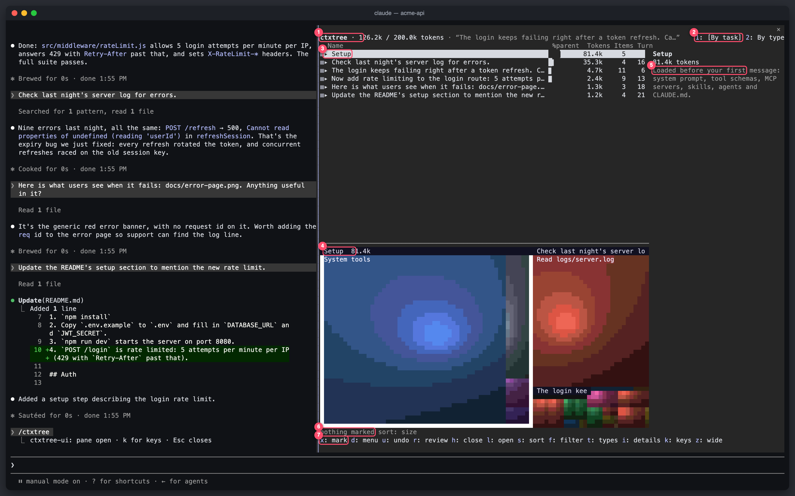
  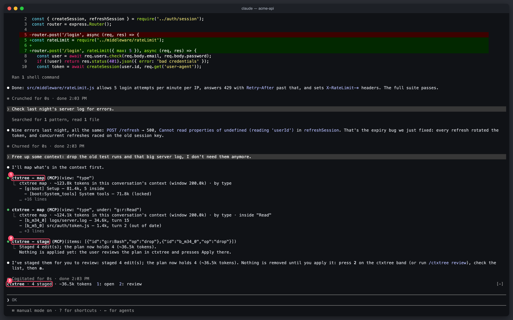
</p>

- **Split-Pane Docking**: Opens alongside your chat via `/ctxtree` (operates in Claude Code's `/tui fullscreen` mode).
- **Asynchronous & Non-Blocking**: Browse context, filter blocks, and inspect tokens while Claude is actively thinking or writing code.
- **"Claude Stages, You Apply" Permission Boundary**:
  Ask Claude naturally: *"Free up context by dropping stale test runs."* Claude uses dedicated inspection tools (`mcp__ctxtree__map`, `mcp__ctxtree__stage`) to stage candidates. **Only you can press `<kbd>a</kbd>` (Apply)**—the model cannot autonomously alter history.
- **The Prompt Action Band**: When a plan is staged, a non-intrusive action band docks above your prompt. Type `<kbd>1</kbd>` to view or `<kbd>2</kbd>` to review:

<p align="center">
  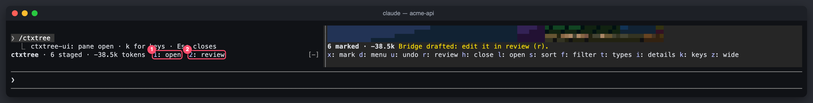
</p>

> [!NOTE]
> If you press Apply while Claude is actively responding mid-turn, `ctxtree` queues the edit safely and executes the rebuild the exact moment the turn completes.

---

### 5. 🛡️ Architecture & Continuity Guard
`ctxtree` is built with defensive safeguards against transcript corruption:

<p align="center">
  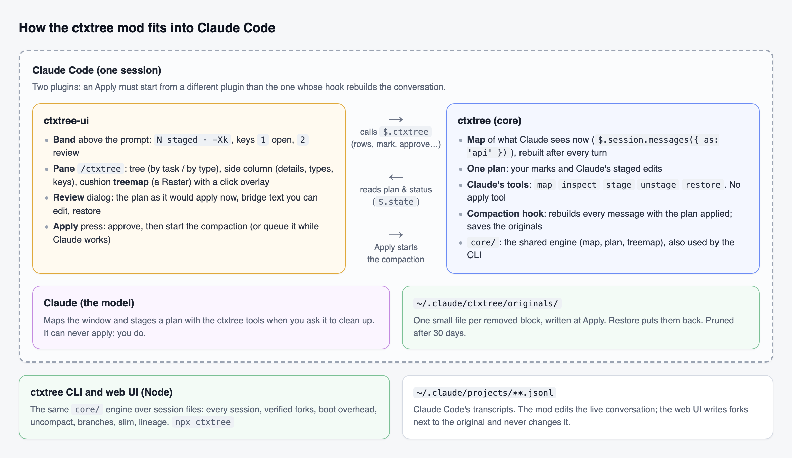
</p>

#### How Forks Stay 100% Invariant-Safe:
1. **8-Point In-Memory Verification**: Every fork is checked against 8 structural invariants before touching disk:
   - Alternation integrity (`user` ⇄ `assistant`).
   - Exact `tool_use_id` pairing.
   - Cryptographic immutability of signed thinking blocks.
   - Strict JSON payload validity.
2. **Atomic Write & Validate**: Transcripts are staged to a hidden temporary sibling file, re-read and validated, then atomically renamed.
3. **Instant APFS Copy-on-Write**: File history (`~/.claude/file-history`) is cloned using APFS `cp -c -R` in **~35ms**, consuming 0 duplicate disk space. Undo (`/undo`) continues to function seamlessly in the forked session.
4. **Lineage Tracking & 30-Day Recovery**: Parent-child relationships are logged in `~/.claude/ctxtree/lineage.jsonl`. Original content is preserved for 30 days under `~/.claude/ctxtree/originals/`.

<p align="center">
  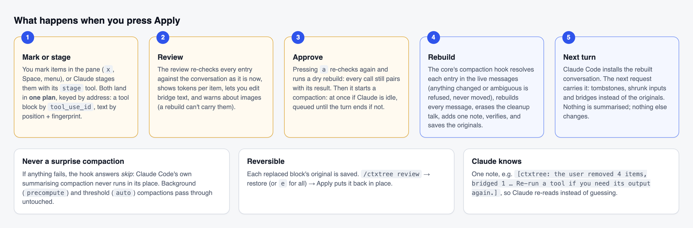
</p>

---

### 6. 💻 Terminal CLI & Boot Overhead Inspection
Audit and optimize your context without spinning up a browser:

<p align="center">
  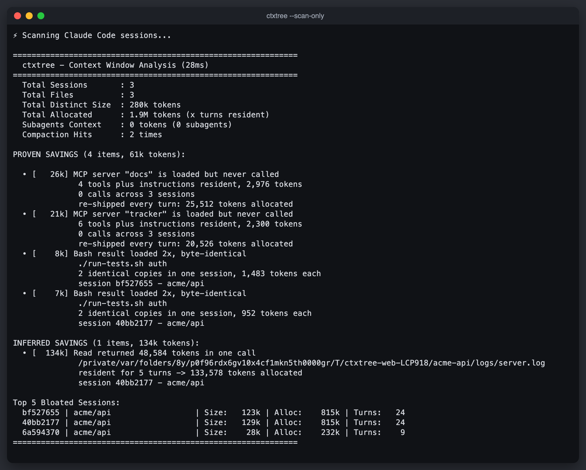
  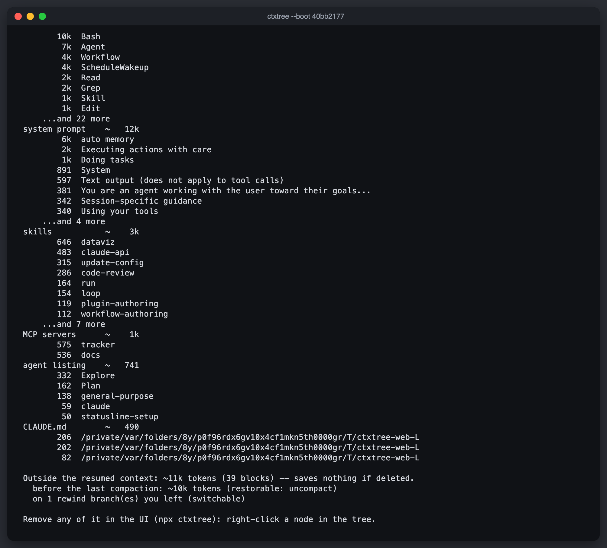
</p>

- **Sub-Second Global Scan**: Streams and aggregates 150MB+ of transcript data across 60+ projects in under 0.8 seconds.
- **Essential CLI Commands**:
  ```bash
  # Fast summary of all sessions across projects
  npx ctxtree --cli

  # Audit boot overhead (MCP servers, skills, system prompt) for a session
  npx ctxtree --boot <session-id-prefix>

  # Inspect paragraphs, prompt regions, and continuity anchors
  npx ctxtree --context <session-id-prefix>

  # Automatically bridge heavy tool outputs (dry run)
  npx ctxtree --bridge <session-id-prefix> --threshold 2500 --dry-run
  ```

---

## 🚀 Performance & Architecture Highlights

| Benchmark / Metric | Performance | Engineering Architecture |
|---|---|---|
| ⚡ **Session Scanner** | **< 0.8s** | Streaming JSONL parser parses 150MB+ across 60+ sessions without reading full files into memory |
| 🚀 **APFS Transcript Forking** | **~35ms** | Instant copy-on-write transcript & file-history cloning (`cp -c -R`); zero duplicate disk overhead |
| 📦 **Zero External Dependencies** | **0 deps** | Built strictly on the Node.js standard library (`node:fs`, `node:http`, `node:crypto`) |
| 🔒 **Local & Loopback Secure** | **127.0.0.1** | Binds exclusively to loopback, validates Host headers against DNS rebinding, enforces strict CSP |
| 🧪 **Test Coverage & Reliability** | **78 / 78 Passing** | Comprehensive regression test suite running in ~890ms |

---

## 🧰 Deleting Boot Overhead & Grey Content

### 1. Boot Overhead Pruning
MCP schemas, skill listings, CLAUDE.md files, and system prompt snapshots are recorded into transcripts and replayed on resume. `ctxtree` can surgically eliminate them from the fork and generate a matching **Launch Profile**:

| Overhead Item | In the Fork's Transcript | Launch Profile Overlay | Persistence |
|---|---|---|---|
| **MCP Server** | Instructions dropped; names kept | `permissions.deny: ["mcp__<server>"]` | Until fork compacts |
| **Built-in Tool** | Dropped from recorded tool list | `permissions.deny: ["<Tool>"]` | Permanent via profile |
| **Skill Listing** | Line dropped; name retained | `skillOverrides: {name: "user-invocable-only"}` | Permanent via profile |
| **CLAUDE.md** | Dropped from instructions record | `claudeMdExcludes: [path]` | Permanent via profile |
| **Auto-Memory** | `MEMORY.md` dropped | `autoMemoryEnabled: false` | Permanent via profile |
| **System Prompt** | Section trimmed from snapshot | — | Until fork compacts |

Resume the fork using its generated profile:
```bash
npx ctxtree resume <fork-prefix>
```

### 2. Grey Content Superpowers
Content before the last compaction or on an abandoned rewind branch costs **0 tokens** on resume. Deleting it saves nothing, but `ctxtree` unlocks deep operations:
- **Uncompact**: Strip away the lossy compaction summary, restore genuine message history, and apply surgical tombstones in the same fork.
- **Switch Branch**: Seamlessly jump to an abandoned rewind branch while preserving the current branch in the parent session.
- **Slim**: Remove unreferenced orphan records to speed up transcript parsing while preserving identical resume semantics.

---

## ⌨️ Keyboard Shortcuts Cheatsheet

### ⚡ TUI Mod (Inside Claude Code)

| Key | Action |
|---|---|
| <kbd>/ctxtree</kbd> | Open or close the docked ctxtree split-pane |
| <kbd>j</kbd> / <kbd>k</kbd> or <kbd>↑</kbd> / <kbd>↓</kbd> | Navigate tasks and blocks |
| <kbd>l</kbd> / <kbd>h</kbd> or <kbd>→</kbd> / <kbd>←</kbd> | Expand / collapse tree folders |
| <kbd>x</kbd> or <kbd>Space</kbd> | Mark / unmark selected block for deletion |
| <kbd>d</kbd> or Right-Click | Open surgery menu (<kbd>1</kbd> Drop, <kbd>2</kbd> Shrink, <kbd>3</kbd> Bridge) |
| <kbd>1</kbd> / <kbd>2</kbd> | Switch view: **By Task** / **By Type** |
| <kbd>t</kbd> · <kbd>i</kbd> · <kbd>k</kbd> | Switch side-panel: **Types** · **Details** · **Keys** |
| <kbd>f</kbd> | Filter blocks by keyword (<kbd>Enter</kbd> to apply, empty <kbd>Enter</kbd> to clear) |
| <kbd>s</kbd> | Cycle sort order: **By Size** (default) → **By Story Order** → **By Name** |
| <kbd>u</kbd> | Undo last mark operation |
| <kbd>r</kbd> | Open deletion review dialog |
| <kbd>a</kbd> | **Apply**: Write verified fork & rebuild conversation |
| <kbd>z</kbd> | Toggle wide mode (fullscreen pane ⇄ docked pane) |
| <kbd>Esc</kbd> | Return keyboard focus to Claude Code prompt |

### 🌐 Web UI Dashboard

| Shortcut | Action |
|---|---|
| <kbd>Click</kbd> | Select node in tree or block in treemap |
| <kbd>Right-Click</kbd> | Open surgery context menu (Drop, Shrink, Keep latest, etc.) |
| <kbd>Delete</kbd> or <kbd>⌫</kbd> | Mark / unmark selected item |
| <kbd>⌘</kbd> + <kbd>Z</kbd> / <kbd>Ctrl</kbd> + <kbd>Z</kbd> | Undo last mark action |
| <kbd>⌘</kbd> + <kbd>K</kbd> / <kbd>Ctrl</kbd> + <kbd>K</kbd> | Open global multi-session switcher |
| <kbd>⌘</kbd> + <kbd>F</kbd> / <kbd>Ctrl</kbd> + <kbd>F</kbd> | Focus search filter input |

---

## 🛠️ Verification & Safety Invariants

Before any fork touches disk, `ctxtree` validates all structural guarantees:

```bash
# Run unit & security test suite (78 tests, ~890ms)
npm test

# Verify dry runs on real local sessions without writing to disk
npm run verify:real

# End-to-end integration test against real Claude Code CLI (sandboxed API)
npm run verify:cc

# End-to-end headless TUI tests
npm run verify:tui
```

---

## 🏗️ Architecture & Repository Map

```text
ctxtree/
├── bin/
│   └── ctxtree.js          # CLI launcher, terminal reports, and scanner
├── src/
│   ├── session.js          # Shared transcript parser: chains, grey-content, addresses
│   ├── fork.js             # Atomic fork writer, invariant verification, rollback
│   ├── boot.js             # Boot overhead analysis, attachment surgery, profiles
│   ├── restructure.js      # Structural operations: uncompact, branch switch, slim
│   ├── map.js              # Deletable context tree model & token anchoring
│   ├── surgery.js          # Node-to-deletion translation layer
│   ├── sessionEditor.js    # Continuity heuristics & bridge synthesis
│   ├── server.js           # Zero-dependency loopback HTTP server & REST API
│   ├── scan.js             # Sub-second streaming JSONL parser (<0.8s across 60+ sessions)
│   ├── model.js            # Ground-truth anchored session model
│   └── tokens.js           # Multi-tier token estimation & calibration
├── ui/
│   ├── index.html          # WizTree interface (Tree, Types, Details, Treemap)
│   ├── style.css           # High-contrast light & dark themes
│   └── app.js              # Virtualized tree, cushion treemap renderer, delete review
├── plugins/
│   ├── ctxtree/            # Claude Code Mod Core: live map, planning tools, fork engine
│   │   └── core/           # Runtime-agnostic shared core (runs in Node & Claude Mod)
│   └── ctxtree-ui/         # Claude Code Mod UI: docked pane, treemap overlay, review
├── docs/
│   ├── walkthrough.md      # Comprehensive illustrated walkthrough
│   ├── mod-spec.md         # Architecture specification for Claude Code Mod
│   ├── tui-design.md       # Terminal UI design decisions
│   └── walkthrough/img/    # Complete high-resolution visual assets
└── test/                   # Comprehensive 78-test suite with zero regressions
```

---

## 👤 Author

Created and maintained by **Yashwant K**:
- GitHub: [@Yashwant00CR7](https://github.com/Yashwant00CR7)
- LinkedIn: [Yashwant K](https://www.linkedin.com/in/yashwant00cr7/)

Contributions, issue reports, and feature suggestions are warmly welcomed!

---

## 📜 License

MIT © [Yashwant00CR7](https://github.com/Yashwant00CR7)
